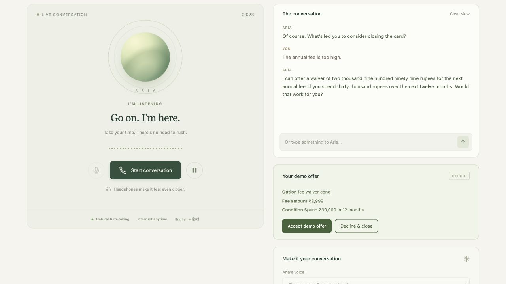
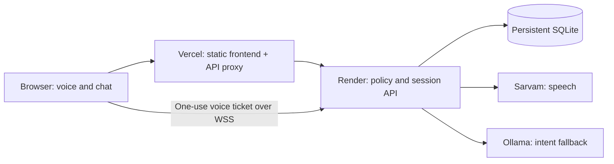

<p align="center">
  
</p>

<p align="center">
  <a href="https://github.com/Meet547/vaani/actions/workflows/ci.yml"></a>
  
  
  
</p>

<p align="center">
  <a href="#meet-vaani">Meet Vaani</a> ·
  <a href="#try-a-conversation">Try a conversation</a> ·
  <a href="#run-it-locally">Run locally</a> ·
  <a href="docs/DEPLOYMENT.md">Deploy</a> ·
  <a href="docs/CSV_INTEGRATION.md">Understand the data</a>
</p>

## Meet Vaani

Some conversations need a little patience. A customer wants to close a card. The fee feels too high. There are points left over, an EMI to account for, or simply a firm decision that deserves to be respected.

Vaani is a working voice and chat sandbox for those moments. Its assistant, **Aria**, speaks in English and Hindi, gives people room to pause, and lets them interrupt. When someone decides to close, the conversation moves forward with a checklist and a clear confirmation.

The voice is meant to feel warm and natural. Aria identifies herself as a virtual assistant. Every account and banking action in this project is synthetic.

<p align="center"></p>

## Try a conversation

Choose **New conversation**, or just say/type hello. Aria asks for your name, finds matching records, and confirms the right person before reading card details. If a saved issue exists, she checks whether it is still what you need help with today. Duplicate names require a full name, city or an explicit selection.

If your name is new, Aria can collect a name, optional city and short enquiry, review the details with you, then save a synthetic profile in SQLite after confirmation. The profile is available in later conversations and survives restarts. New enquiry profiles have no invented card balances or offer eligibility.

Chat works without provider keys; live speech needs Sarvam. To run the preloaded walkthroughs below, choose **Test a selected customer scenario** and open the profile settings. Normal conversation stays the default and never adopts a CSV trigger on its own.

<details open>
<summary><strong>“The annual fee is too high.” — Riya</strong></summary>

Select **H-CARD-1**. Aria can explain a conditional fee waiver using the account facts and the configured limits. Accept it to see the simulated change, or decline and continue to closure. A second retention pitch is not allowed after that decline.

</details>

<details>
<summary><strong>“Just close my card. No offers.” — Sameer</strong></summary>

Select **H-CARD-4**. The account has ₹12,500 in dues, including ₹4,000 in EMIs, and 2,000 reward points. Skip or redeem the points, review the checklist, and explicitly confirm. The request is saved as `pending_dues` with a reference. Dues do not prevent recording the request.

</details>

<details>
<summary><strong>“I don’t recognise this transaction.” — Neha</strong></summary>

Select **H-CARD-3**. Her open fraud ticket routes the session straight to a simulated fraud queue. There is no retention offer and no claim that a real person has joined the call.

</details>

<details>
<summary><strong>Explore a gold-loan profile</strong></summary>

Search for **H-LR-1**, or choose **Gold only** in the product filter. Enquiry, loan and collateral facts are available to inspect. Gold negotiation, applications and valuation bookings are outside this release. Profiles with both products can still use their validated card journey.

</details>

## What makes the conversation work

- **A voice with room to breathe.** Three Sarvam voices, adjustable pace, streaming playback, microphone echo suppression and interruption handling.
- **One conversation across voice and chat.** Typed messages, spoken turns and on-screen actions share the same policy engine and saved session.
- **A name before an account.** Record lookup, duplicate-name handling and reviewed registration keep the conversation tied to the right profile. This is synthetic profile matching, not real bank authentication.
- **Decisions grounded in code.** Fees, eligibility, offer caps and closure transitions come from validated facts and rules. Ollama only helps classify unfamiliar wording; it cannot approve an action or invent financial terms.
- **Room for follow-up questions.** Ask about points, dues or fees while discussing an offer. Aria answers from the same account snapshot, keeps the pending terms, and admits when details such as APR or transaction dates are missing. Uncertain model interpretations need your clarification before changing the journey.
- **Replies that belong to the current question.** “Haa kardo fir redeem” redeems points during the points step and moves to a separate closure confirmation. A lost-card report pauses retention to distinguish blocking help from permanent account closure. [Conversation logic](docs/CONVERSATION_LOGIC.md) explains the flow and its limits.
- **A visible finish.** Explicit confirmations, written references, saved snapshots and an audit trail make it possible to follow what happened.
- **A useful dataset.** Search 250 synthetic profiles by name, ID or city. There are 160 card profiles, 110 with gold details and 20 in both groups. Of the card profiles, 148 are ready for a demo; the other 12 show their data/status issues.

## Run it locally

Use Node.js 24, or Node.js 22.13 and later within the 22 line.

```sh
git clone https://github.com/Meet547/vaani.git
cd vaani
npm ci
npm run dev:secure
```

The terminal asks for your Sarvam and Ollama keys without displaying them. Keep it running, then open **http://localhost:4317**. Keys stay in the server process and never go into the frontend bundle.

For an offline walkthrough, use `npm run dev` with no keys. Card policy flows still work in chat, and a generated voice excerpt is available under **Behind the voice & data**. Open the HTTP address above; opening `public/index.html` as a file will not connect the app.

## Deploy on Vercel and Render

The repo includes both deployment configurations. Vercel serves the frontend and proxies `/api/*` to Render. Render runs the HTTP API, the live WebSocket connection and SQLite on a persistent disk.

The public backend is configured as `https://vaani-backend-vv52.onrender.com` in [`config/deployment.json`](config/deployment.json). Vercel builds use it automatically; an optional `BACKEND_URL` environment variable can override it. If an older override is malformed, remove or correct it and redeploy.



**Start with [the deployment guide](docs/DEPLOYMENT.md).** It covers the two URLs, exact environment variables, persistent disk, preview domains and the final hosted smoke check. The Render blueprint selects a paid Starter service with a 1 GB disk; review that choice before creating resources. This repository upload does not create either hosted service.

## Find your way around

```text
vaani/
├── public/                 Browser UI, audio playback and microphone worklet
├── lib/                    Policy engine, services, providers, storage and transport auth
├── config/
│   ├── deployment.json     Public backend origin used by the frontend build
│   ├── datasets/           Unchanged synthetic source CSV
│   ├── negotiation/        Offer/closure policy and demo calendar
│   └── policy/             Tier rules and authority limits
├── services/card/          Reviewed demo disclosures
├── scripts/                Local startup, frontend build, data checks and live probes
├── tests/                  Policy, data, persistence, audio and deployment tests
├── docs/                   Deployment guide, design decisions and source briefs
├── artifacts/              Generated backup audio and demo evidence
├── .github/workflows/      Verification on pushes and pull requests
├── server.mjs              HTTP/WebSocket entry point
├── render.yaml             Backend service and persistent disk
└── vercel.json             Frontend build entry point
```

Runtime databases, local environment files, installed dependencies and generated Vercel output are excluded from Git. `config/customers.yaml` holds the original four regression fixtures; the CSV is the default customer source.

## Check before shipping

```sh
npm run check
npm test
npm run data:validate
npm audit --omit=dev --audit-level=high
```

The suite covers offer budgets, firm closure intent, confirmation tokens, duplicate requests, fraud routing, consent/DND, all actionable imported customers, saved sessions, audio boundaries and the hosted ticket flow. Longer dialogue tests cover topic changes, corrections, model guesses, unsupported facts and confirmation after a factual detour. GitHub Actions runs these checks and a frontend build on Node.js 22 and 24.

For real provider checks, start the local server with keys and run `npm run test:live` and `node scripts/classifier-smoke.mjs`. These create synthetic sessions and consume provider quota. A microphone audition is still useful: room acoustics, device quality and network conditions affect how a conversation feels.

## A few honest boundaries

This is a hardened demo prepared for hosting, with simulated banking services. It has no real bank authentication, account mutation, bureau pull, SMS delivery or live human transfer. The hosted demo is publicly accessible without a login or access code; use synthetic data only and monitor provider usage. Session cookies separate demo sessions but do not verify customer identity.

The source data also has a few rough edges. Ten records have conflicting EMI/dues amounts and two have non-active card statuses; they remain read-only. `C0030` has a CSV tier expectation that differs from the documented first-match policy. Both the issue list and the reasoning are in [CSV integration notes](docs/CSV_INTEGRATION.md).

SQLite and short-lived tickets currently belong to one backend instance. Use a single Render instance with a persistent disk. Horizontal scaling and real-customer operations need a shared datastore and a separate operational design.

## Keep reading

[Deployment](docs/DEPLOYMENT.md) · [Customer onboarding](docs/CUSTOMER_ONBOARDING.md) · [Local development](docs/LOCAL_DEVELOPMENT.md) · [Demo walkthrough](docs/DEMO_GUIDE.md) · [CSV mapping](docs/CSV_INTEGRATION.md) · [Implementation decisions](docs/IMPLEMENTATION_NOTES.md) · [Security](SECURITY.md) · [Contributing](CONTRIBUTING.md)

The original [card rulebook](docs/source/card_closure_rulebook.md) and [voice/chat brief](docs/source/card_retention_agent_voice_chat.md) are preserved for reference. Executable policy lives in YAML and code; editing a brief alone does not change the running assistant.
